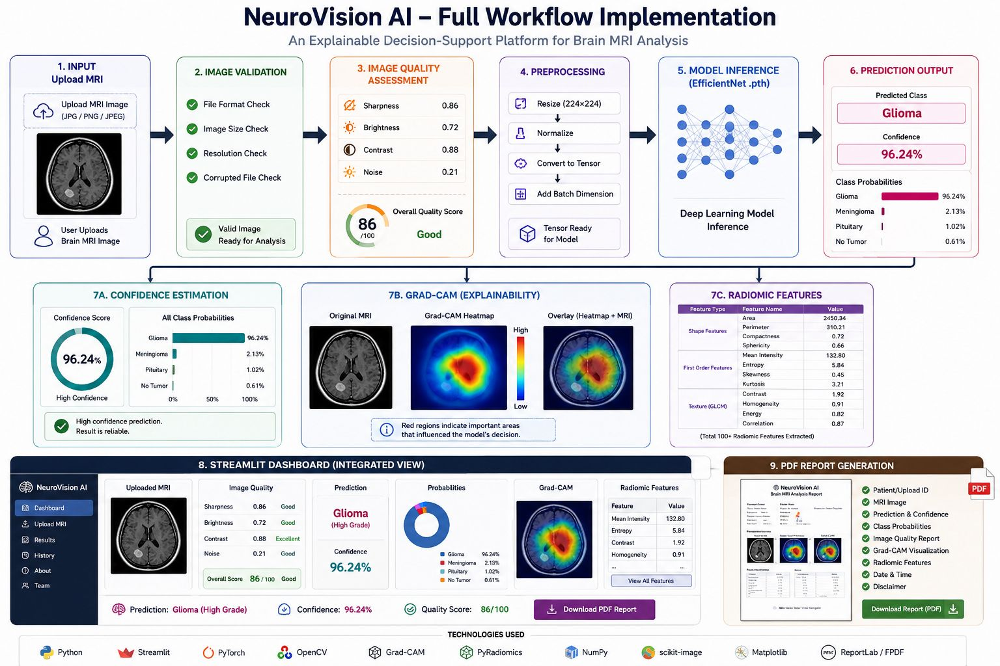

# NeuroVision AI

**Explainable decision support for brain MRI.** An EfficientNet-B0 model classifies the scan, an image-quality check says whether the input is good enough to trust, and Grad-CAM shows which region drove the prediction. Everything is delivered as a FastAPI + React web app that exports a PDF report.


---

## Why it matters

A prediction only helps a clinician if three questions are answered: how sure is the model, was the image good enough, and what part of the scan led to the answer? NeuroVision AI answers all three on one results screen.

## Features

- **Tumour classification.** EfficientNet-B0 with ImageNet weights, fine-tuned on the [Brain Tumor MRI Dataset](https://www.kaggle.com/datasets/masoudnickparvar/brain-tumor-mri-dataset) for four classes: glioma, meningioma, pituitary and no tumour.
- **Image quality assessment.** Scores each scan for sharpness, brightness, contrast and noise, combines them into an overall quality grade and flags blurry, dark or noisy inputs.
- **Explainability.** Grad-CAM heatmaps overlaid on the MRI slice.
- **Clinical-style workflow.** Patient ID, guided processing steps, a results dashboard and a one-click PDF report.

## Results

Held-out test set:

| Accuracy | Precision | Recall | F1-score | ROC-AUC |
|:---:|:---:|:---:|:---:|:---:|
| 90.38 % | 91.26 % | 90.38 % | 90.13 % | 96.71 % |

## How it works



## Repository

| Path | What it is |
|---|---|
| `Copy_of_NeuroVision_AI_Training.ipynb` / `.py` | Data loading, EfficientNet-B0 fine-tuning and evaluation |
| `NeuroVision_Image_Quality_Assessment.ipynb` / `.py` | Sharpness, brightness, contrast and noise scoring with a quality dashboard |
| `best_model_finetuned.pth` | Trained model weights |
| `neurovision_ai.zip` | The full-stack app: `backend/` (FastAPI) and `frontend/` (React + Vite) |
| `Test_Images.zip` | Sample MRI slices to try the app |
| `Flow_Chart.jpeg` | Pipeline diagram |

## Run it locally

Unzip `neurovision_ai.zip` first. You need two terminals: one for the backend, one for the frontend.

**1. Backend (FastAPI + PyTorch).** Needs Python 3.9 or newer.

```bash
cd neurovision_ai/backend
python3 -m venv venv
source venv/bin/activate          # Windows: venv\Scripts\activate
pip install -r requirements.txt
export PYTHONPATH=.               # Windows: set PYTHONPATH=.
uvicorn app.main:app --reload --port 8000
```

The API docs (Swagger UI) are then at http://localhost:8000/docs.

**2. Frontend (React + Vite).** Needs Node.js 18 or newer.

```bash
cd neurovision_ai/frontend
npm install
npm run dev
```

Open the local URL Vite prints, usually http://localhost:5173/.

## Using the app

1. Click **Welcome** on the landing page.
2. Enter any patient ID (for example `PID-983472`).
3. Upload a T1c or T2 brain MRI slice (JPG or PNG) and submit.
4. Follow the processing steps, then explore the results dashboard: diagnosis, image-quality scores and Grad-CAM heatmap.
5. Click **Export PDF** to download the report.

## Disclaimer

This is a research and education project, not a medical device. It must not be used for clinical diagnosis.

## License

[MIT](LICENSE)
